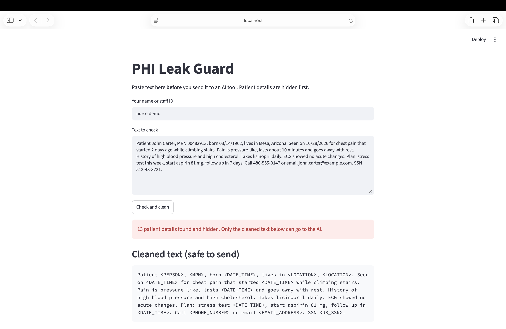
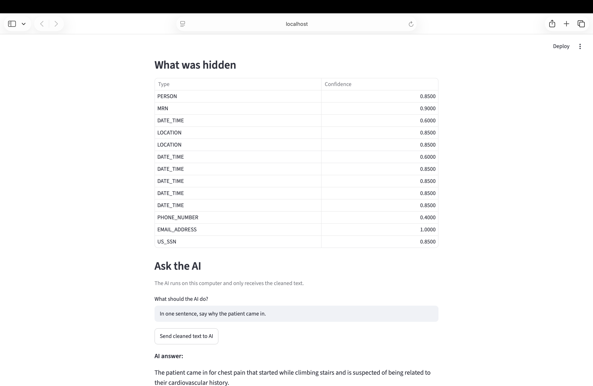
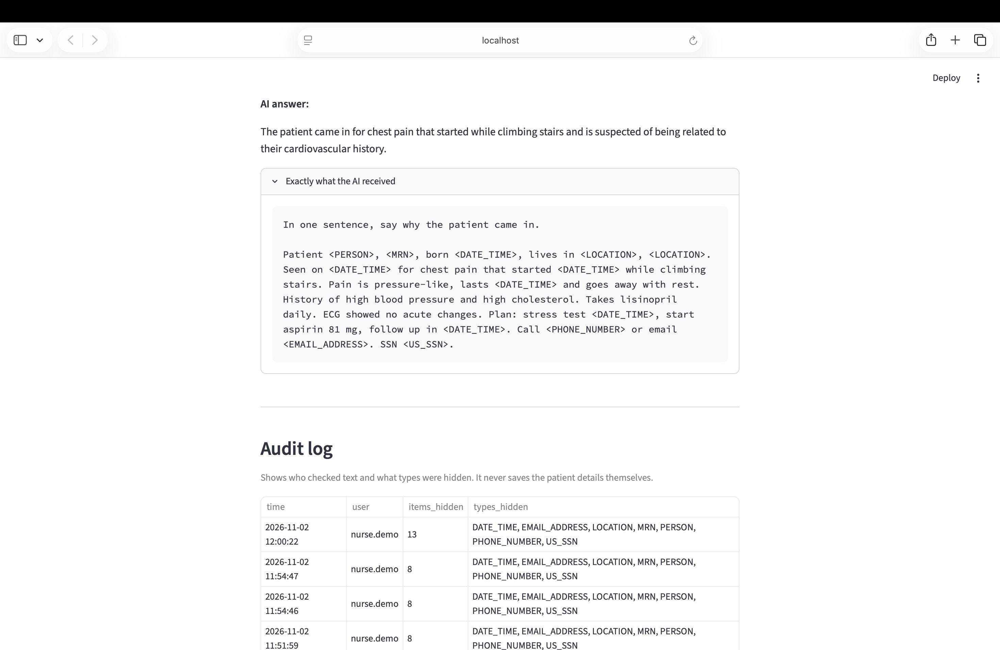

# PHI Leak Guard

A local web app that detects and masks Protected Health Information (PHI) in clinical text before it is sent to an AI model, and records every check in a privacy-safe audit log.

> **In plain words:** Doctors and nurses sometimes paste patient notes into AI chatbots to get a quick summary. If that note has the patient's name or Social Security number in it, private information leaks out. This app works like a black marker: it crosses out the private details *first*, and only then lets the AI read the note.

**Built with:** Python · Microsoft Presidio · spaCy · Streamlit · Ollama (local AI, `qwen2.5:3b`)

**Cost:** free. Everything runs on your own computer.

> **In plain words:** These are the free tools it's made from. Nothing gets sent to the internet, not even to the AI, because the AI runs right on the laptop.

> ⚠️ Demo project. Use fake patient data only. This is not a certified HIPAA compliance tool.

---

## Screenshots

**1. Paste a note and clean it**



> **In plain words:** You paste a note, click one button, and every private detail turns into a label like `<PERSON>` or `<US_SSN>`.

**2. See what was hidden, then ask the AI**



> **In plain words:** The table lists *what kind* of info was hidden and how sure the app was (1.0 = 100% sure). The AI still answers the medical question without knowing who the patient is.

**3. Proof of what the AI saw, and the audit log**



> **In plain words:** You can open the box and see *exactly* what the AI received: only labels, no real details. The logbook below records every check, but never the private info itself.

---

## Why I built it

Under HIPAA, sharing PHI with an unapproved third-party service can be a data breach. As generative AI tools spread through healthcare, staff may paste identifiable notes into them without realizing the risk. PHI Leak Guard adds a control *before* the AI: detect, mask, log, then send.

> **In plain words:** HIPAA is the US law that protects patients' medical privacy. Pasting a real patient note into a public chatbot can break that law, even if nobody meant any harm. This app is like a security guard at the door: it checks what's going out and removes anything private before it leaves.

---

## How it works

```
Clinical note  →  1. Detect PHI  →  2. Mask it  →  3. Log the types  →  4. Send ONLY masked text to local AI
                  (Presidio +       (<PERSON>,     (audit_log.csv,       (Ollama, runs on
                   custom MRN        <MRN>, ...)    no patient data)       this computer)
                   recognizer)
```

**Defense in depth:** the user's question to the AI is also scanned and masked, in case PHI is typed into it.

> **In plain words:**
> 1. **Find:** it reads the note and spots private details, like a teacher scanning for names on an anonymous test.
> 2. **Hide:** it swaps each one for a label. "John Carter" becomes `<PERSON>`.
> 3. **Write it down:** it keeps a logbook of *what kind* of info was hidden (for example "1 name, 1 SSN"), but never the info itself.
> 4. **Ask the AI:** only the cleaned note goes to the AI.
>
> It even checks the question you type to the AI, in case someone types a patient's name there by accident. It's like locking both the front door *and* the back door.

---

## What it detects

| Type | Example (fake) | How it's detected |
|---|---|---|
| Name | John Carter | Presidio + spaCy NER model |
| Medical record number | MRN 00482913 | Custom regex recognizer I added |
| Dates | 03/14/1962 | Presidio |
| Location | Mesa, Arizona | Presidio |
| Phone | 480-555-0147 | Presidio |
| Email | john.carter@example.com | Presidio |
| SSN | 512-48-3721 | Presidio (with checksum rules) |

Covers 7 of HIPAA's 18 Safe Harbor identifier types.

> **In plain words:** HIPAA lists 18 kinds of details that can identify a patient. This app catches 7 of the most common ones so far. Some it finds by understanding language (it knows "John Carter" is a person). Others it finds by spotting a pattern (an MRN is always "MRN" followed by numbers), like recognizing a phone number by its shape.

---

## Example

**Input (fake note):**
```
Patient John Carter, MRN 00482913, born 03/14/1962, lives in Mesa, Arizona. Seen on 10/28/2026 for chest pain that started 2 days ago while climbing stairs. Pain is pressure-like, lasts about 10 minutes and goes away with rest. History of high blood pressure and high cholesterol. Takes lisinopril daily. ECG showed no acute changes. Plan: stress test this week, start aspirin 81 mg, follow up in 7 days. Call 480-555-0147 or email john.carter@example.com. SSN 512-48-3721.
```

**What the AI receives:**
```
Patient <PERSON>, <MRN>, born <DATE_TIME>, lives in <LOCATION>, <LOCATION>. Seen on <DATE_TIME> for chest pain that started <DATE_TIME> while climbing stairs. Pain is pressure-like, lasts <DATE_TIME> and goes away with rest. History of high blood pressure and high cholesterol. Takes lisinopril daily. ECG showed no acute changes. Plan: stress test <DATE_TIME>, start aspirin 81 mg, follow up in <DATE_TIME>. Call <PHONE_NUMBER> or email <EMAIL_ADDRESS>. SSN <US_SSN>.
```

**AI answer:** "The patient came in for chest pain that started while climbing stairs and is suspected of being related to their cardiovascular history."

**Audit log row:**
| time | user | items_hidden | types_hidden |
|---|---|---|---|
| 2026-11-02 12:00:22 | nurse.demo | 13 | DATE_TIME, EMAIL_ADDRESS, LOCATION, MRN, PERSON, PHONE_NUMBER, US_SSN |

> **In plain words:** The AI still understood the medical part (chest pain on the stairs, blood pressure history), but it never learned *who* the patient was. The logbook shows 13 private details were hidden, without writing them down again. Notice that "2 days ago" and "10 minutes" got hidden too, which is the over-masking problem listed below. And the AI's "suspected" heart link was its own guess, which is why a clinician must check its answers.

---

## Limitations (what I found while testing)

| Finding | In plain words |
|---|---|
| **Over-masking:** durations like "2 days ago" and "10 minutes" are tagged as `DATE_TIME`. | It sometimes hides things that aren't private, like "10 minutes". That's the safe mistake, but the AI loses useful medical details. |
| **Hallucination:** the model once said the pain was "suspected" to be cardiac, which the note did not say. | The AI made a guess and said it like a fact. A doctor or nurse must always check the AI's answer. |
| **Over-refusal:** `llama3.2` refused to process fully masked notes, so I switched to `qwen2.5:3b`. | The first AI was so nervous it refused to help even when the note was already safe. I tested another one that worked. |
| **Low-confidence matches:** phone numbers scored 0.40, just above the 0.35 threshold. | The app was only "40% sure" about phone numbers. If I made it stricter, it would start missing them. |
| **Known test SSNs are skipped:** Presidio ignores numbers like 123-45-6789. | Famous fake SSNs get ignored on purpose, so testing needs a realistic-looking fake number. |
| **Coverage:** 7 of 18 HIPAA identifier types. | It doesn't catch everything yet, like street addresses or insurance IDs. |

---

## How to run it (Mac)

**1. Get the code and set it up**
```bash
git clone https://github.com/astha2310/phi-leak-guard.git
cd phi-leak-guard
python3 -m venv venv
source venv/bin/activate
pip install -r requirements.txt
python -m spacy download en_core_web_lg
```

> **In plain words:** Download the project, make a clean "box" for it so it doesn't mess with anything else on your computer, then install the tools it needs, like unpacking ingredients before cooking.

**2. Install the free local AI**
Download Ollama from [ollama.com](https://ollama.com), open it, then run:
```bash
ollama pull qwen2.5:3b
```

> **In plain words:** This puts a small AI on your own laptop, so notes never leave your computer.

**3. Start the app**
```bash
python -m streamlit run app.py
```
It opens in your browser at `http://localhost:8501`.

> **In plain words:** This turns the app on. It shows up as a web page, but it only lives on your computer.

---

## Files

| File | What it does | In plain words |
|---|---|---|
| `find_phi.py` | Runs Presidio detection on a sample note | Step 1: finding private details |
| `guard.py` | Adds the MRN recognizer and anonymizes text | Step 2: hiding them |
| `app.py` | Streamlit UI, local AI and audit log | The finished app you click on |
| `requirements.txt` | Python dependencies | The shopping list of tools to install |

---

## What I learned

| Technical | In plain words |
|---|---|
| PHI detection combines rule-based recognizers (regex) with ML-based NER. | Some private details are found by pattern, others by understanding language. You need both. |
| Confidence thresholds trade recall against precision. | Too strict and it misses private info. Too loose and it hides everything. |
| Audit logs should prove *what happened* without storing the sensitive data again. | A good logbook says "a name was hidden", not the name itself. |
| Local LLMs vary widely in refusal and hallucination behavior, so model selection is part of the security design. | Different AIs behave very differently. Testing and picking the right one is part of keeping things safe. |

## Next ideas

- Stop durations ("10 minutes") from being masked as dates.
- Add more HIPAA identifiers (street addresses, insurance IDs, account numbers).
- Block sending to the AI if a high-risk detail (like an SSN) is found and not masked.

---

Built by **Astha Patel** · [LinkedIn](https://www.linkedin.com/in/asthap23) · [GitHub](https://github.com/astha2310)
